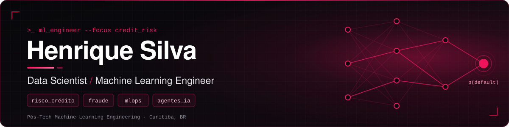

<!-- ═════════════════════════════  HEADER  ═════════════════════════════ -->
<p align="center">
  
</p>

<p align="center">
  <a href="https://git.io/typing-svg">
    
  </a>
</p>

<p align="center">
  <a href="https://www.linkedin.com/in/henrique-silva-ds"></a>
  <a href="mailto:henrique3151@icloud.com"></a>
  
  
</p>

<br/>

<!-- ═════════════════════════════  SOBRE  ═════════════════════════════ -->
<table>
<tr>
<td width="58%" valign="top">

### 👋 Sobre mim

Cientista de dados em formação pela **Pós-Tech em Machine Learning Engineering (FIAP + Alura)**, com **mais de 10 anos em telecomunicações** guiado por indicadores, diagnóstico de falhas e decisões rápidas sobre sistemas críticos.

Construo modelos pensando no que acontece **depois do notebook**: como o modelo é avaliado pelo custo do erro, explicado para quem decide, servido por API e monitorado quando o mundo muda.

</td>
<td width="42%" valign="top">

### 🎯 Foco atual

```yaml
papel:      Cientista de Dados / ML Engineer
domínio:    Risco de crédito · Fraude · Churn
produção:   APIs, MLOps e monitoramento de drift
ia:         Agentes com RAG + ferramentas (MCP)
aprendendo: Azure · Databricks · inglês avançado
```

</td>
</tr>
</table>

### 💎 O que me diferencia

| | |
|---|---|
| 🎯 **Avaliação orientada a negócio** | Ponto de corte por custo esperado, calibração, KS/AUC/Brier, SHAP e fairness — não só acurácia. |
| 🏦 **Domínio em risco financeiro** | Score de crédito, tempo até o default, detecção de fraude e monitoramento de carteira. |
| ⚙️ **Mentalidade de produção** | FastAPI em Docker, MLflow, DVC, Airflow, ONNX, Prometheus/Grafana e CI. |
| ✅ **Engenharia com qualidade** | Suítes de 22 a 318 testes automatizados, tipagem estrita e lint. |

<br/>

<!-- ═════════════════════════════  PROJETOS  ═════════════════════════════ -->
## 🚀 Projetos em destaque

<table>
<tr>
<td width="50%" valign="top">

#### 🛡️ [DriftGuard](https://github.com/Henry3151/driftguard-credit-mlops)
<sub>Monitoramento de modelo de crédito · Home Credit · 307 mil clientes</sub>

- XGBoost **AUC 0,74 · KS 0,36** com corte por custo (LGD × margem)
- Drift em 6 meses de crise: **PSI · KS/χ² · MMD · ADWIN**
- Retreino challenger com guardrails: **−54% de perda realizada**
- Pandera · Evidently · Prometheus · LGPD

   

</td>
<td width="50%" valign="top">

#### 💳 [Fintech Risk Framework](https://github.com/Henry3151/Fintech-Risk-Framework)
<sub>4 modelos de risco financeiro · dados públicos reais</sub>

- Credit Score calibrado com **SHAP** e análise de viés
- **Cox PH** em 2,2 mi de empréstimos — C-index 0,68
- Fraude (0,17%): Autoencoder + XGBoost — **PR-AUC 0,87**
- APIs < 50 ms · 55+ testes · 3 dashboards Power BI

   

</td>
</tr>
<tr>
<td width="50%" valign="top">

#### 🩺 [Triagem de Laudos — NLP em produção](https://github.com/Henry3151/triagem-laudos-mlops)
<sub>Classificação de urgência servida em tempo real</sub>

- API FastAPI em Docker
- **ONNX Runtime: 117x mais rápido**
- Retreino com Airflow · Prometheus + Grafana · CI

  

</td>
<td width="50%" valign="top">

#### 📞 [Churn Prediction — Telecom](https://github.com/Henry3151/Churn_Prediction_Advanced_Models_Optimized)
<sub>Retenção de clientes com corte pelo custo do erro</sub>

- MLP (PyTorch) vs. regressão logística: **AUC 0,84 → 0,93**
- F1 0,61 → 0,85 · FN R$ 500 vs. FP R$ 50
- MLflow · Pandera · 22 testes

 

</td>
</tr>
<tr>
<td width="50%" valign="top">

#### 🛒 [Recomendador de E-commerce](https://github.com/Henry3151/recomendador-ecommerce)
<sub>Embeddings neurais com MLOps reproduzível</sub>

- PyTorch · DVC · MLflow · Docker · model card

</td>
<td width="50%" valign="top">

#### ♠️ [Poker AI Tournament Lab](https://github.com/Henry3151/Poker-IA)
<sub>Agentes, simulação e avaliação estatística</sub>

- MCCFR push/fold · avaliação pareada
- **318 testes** · mypy strict · ruff

</td>
</tr>
</table>

<br/>

<!-- ═════════════════════════════  STACK  ═════════════════════════════ -->
## 🧰 Stack

<p align="center">
  
</p>

<div align="center">

| Área | Ferramentas |
|:--|:--|
| **Dados** | Python · Pandas · NumPy · SQL (CTEs, janelas) · BigQuery · PostgreSQL · Spark · Delta Lake · dbt |
| **Machine Learning** | scikit-learn · XGBoost · LightGBM · PyTorch · lifelines (Cox PH) · SHAP · NLP |
| **MLOps** | FastAPI · Docker · MLflow · DVC · Airflow · ONNX · Evidently · Pandera · Prometheus/Grafana |
| **IA generativa** | Agentes com ferramentas (MCP) · RAG · APIs de LLM · Pydantic |
| **Cloud & BI** | AWS (S3, Glue, Athena) · Power BI (DAX) |

</div>

<br/>

<!-- ═════════════════════════════  FORMAÇÃO  ═════════════════════════════ -->
## 🎓 Formação & Certificações

- 🎓 **Pós-Tech em Machine Learning Engineering** — FIAP + Alura · conclusão 03/2027
- 🎓 **Gestão de Tecnologia da Informação** — UNINTER · 2024
- 📜 dbt Fundamentals (dbt Labs) · Intro e Advanced SQL (Kaggle) · Power BI com DAX (Alura)
- 🌎 Inglês intermediário — em evolução na Fluency Academy

<br/>

<p align="center">
  
</p>
